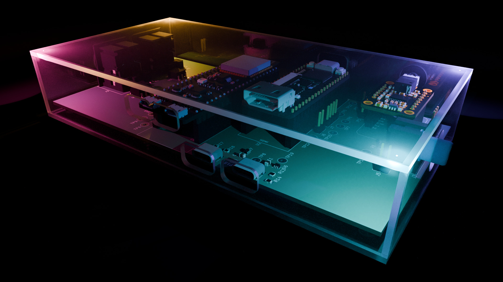
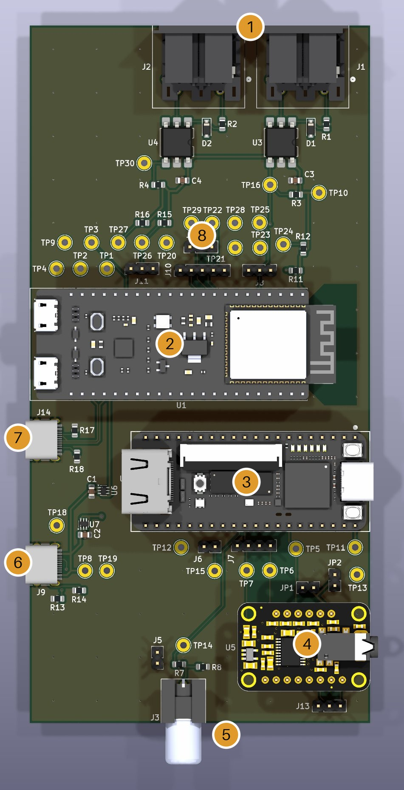
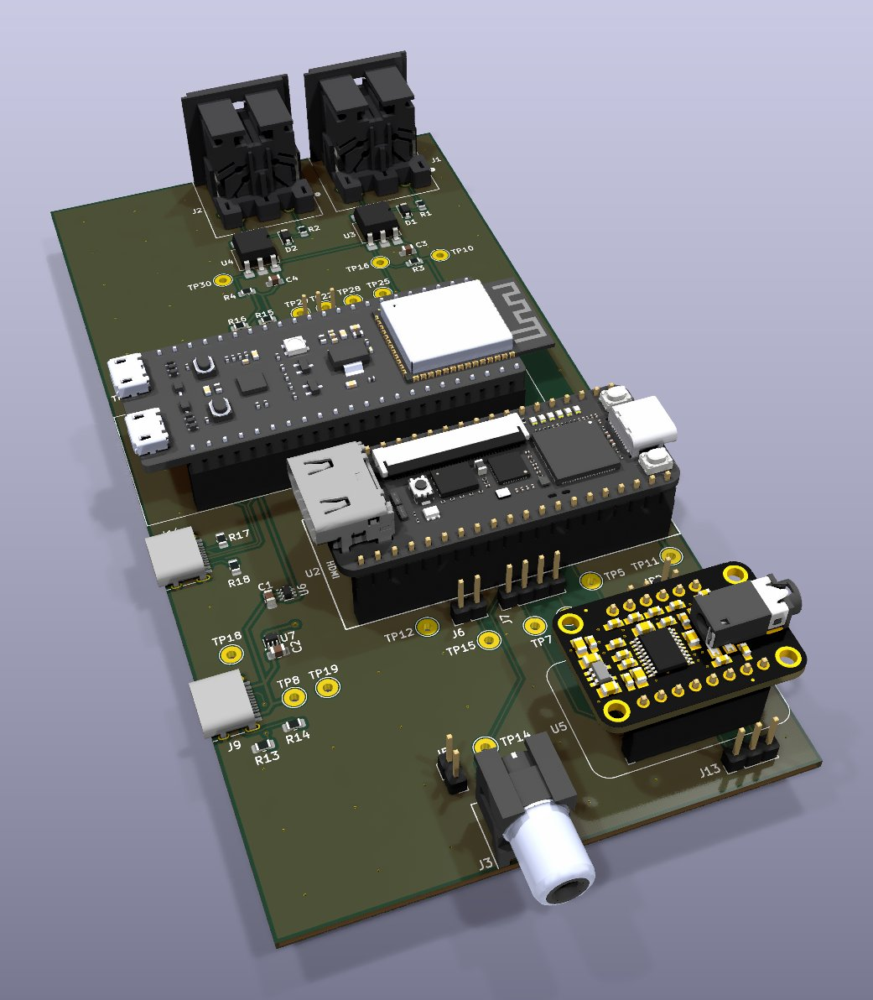
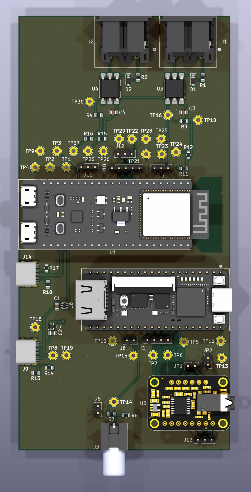
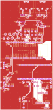
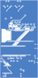

# Noaidi FPGA Synth: the board

The KiCad project for the Noaidi synthesizer's circuit board, in
progress. The gateware and firmware that run on it live in
[Thorwegian/noaidi-fpga-synth](https://github.com/Thorwegian/noaidi-fpga-synth),
and the synth itself is presented at [thj.no/synth](https://thj.no/synth/).

## What is on it

The board is a carrier for three off-the-shelf modules and the few parts
around them, numbered as in the picture:

1. **Two DIN MIDI inputs** (J1, J2) through H11L1 optocouplers (U3, U4),
   the six-legged part below each socket: one for the keyboard, one for
   the dev host.
2. **ESP32-S3-DevKitC** (U1) on headers: MIDI, voices, presets and the
   console. The picture shows Espressif's board; the boards in hand are
   copies with the same pin layout (`docs/esp32s3_hw678.md`).
3. **Tang Nano 20K** (U2) on headers: the sound engine.
4. **Adafruit PCM510x I2S DAC module** (U5): analog audio out, on its
   own 3.5 mm jack and on a pin header.
5. **RCA socket** (J3): S/PDIF out.
6. **USB-C socket for power** (J9), into each module's 5 V rail through
   an LM66100 ideal diode (U6, U7).
7. **USB-C socket for data** (J14): the ESP32's USB data pair, below the
   module's USB pins.
8. **Pin headers** for the second SPI bus, two I2C buses, UART0, I2S and
   S/PDIF, and 29 test points.

Two layers, 130.85 × 121.25 mm, both filled with ground. The modules, the DIN and RCA sockets,
the pin headers and the test points are through-hole; the other parts
are surface-mount.

The board is made from the circuit in text by script: see The circuit
in text, below.

## Layout

Front copper and silkscreen:

Back copper, mirrored:

The three modules are rendered from 3D models of them, each standing in
a socket of two rows of female pin headers: the Tang Nano 20K from
Sipeed's model (`docs/thirdparty/Tang_Nano_20K_3921.step`), the ESP32
module from the model of the ESP32-S3-DevKitC-1-N8R2
(`docs/thirdparty/ESP32-S3-DEVKITC-1-N8R2.STEP`), the DAC module from
Adafruit's model (`docs/thirdparty/6250 PCM510x I2S DAC.step`). The
first two models have the module's pin headers; Adafruit's has none,
and KiCad's model of a pin header stands in under each of its rows.
Each module's underside is 11.04 mm above the base board: the 8.5 mm of
the socket, from KiCad's model of it, and the 2.54 mm body of the
module's pin headers.

The DIN sockets are rendered from a model made of Lumberg's two
(`docs/thirdparty/lumberg_0105_05_with_pins_of_08-1.step`): the body is
that of Lumberg's model of the 0105 05, with its contacts cut off at
the body's underside, and the solder pins below it are those of poles
1 to 5 and the two ground pins of Lumberg's model of the 8-pole
version, the 0105 08-1. Those pins are where Lumberg's drawing and the
footprint have them, which the 0105 05 model's own are not. The colours
are the project's: dark grey for the plastic, as the part is, and
tinned metal for the contacts and pins.

The RCA socket is rendered from Kycon's model of the part
(`docs/thirdparty/KLPX-0848A-2-x.IGS`), unaltered: the housing is dark,
as that of the black KLPX-0848A-2-B is, and the barrel reaches beyond
the board's bottom edge.

The two USB sockets are rendered from a model of the Hroparts
TYPE-C-31-M-12 that is not its maker's
(`docs/thirdparty/Hroparts_TYPE-C-31-M-12_model_ai03.step`). It is a
simplified one: a single solid in one colour, with twelve solder tails
where the part has sixteen, the two of each supply and ground pair
drawn as one. Its shell, mouth, legs and pegs are where Hroparts'
drawing has them.

The ESP32 module's model is from DigiKey's page for the part, the DAC
module's from Adafruit's repository of CAD files on GitHub
([adafruit/Adafruit_CAD_Parts](https://github.com/adafruit/Adafruit_CAD_Parts)).
Of Lumberg's two DIN socket models, the 0105 05's is from DigiKey's
page for the part and the 0105 08-1's from
[Lumberg's page for the 0105](https://www.lumberg.com/en/products/product/0105),
which carries the same file of the 0105 05 as DigiKey. The RCA socket's
model is Kycon's own, and so is its
[dimension drawing](https://cloud.kycon.com/Pub_Eng_Draw/KLPX-0848A-2-x.pdf).
The USB sockets' model is ai03's, from the KiCad library
[ai03-2725/Type-C.pretty](https://github.com/ai03-2725/Type-C.pretty)
on GitHub, which states no licence.

## Files

The root folder holds the KiCad project, this README, `AGENTS.md` and
the licence. Scripts go in `scripts/`, documents in `docs/`.

- `AGENTS.md`: the rules for AI agents working in this repository, who
  does what, and where to start reading.
- `noaidi-fpga-synth.kicad_pro`, `.kicad_pcb`, `.kicad_dru`: the KiCad
  project, which holds the board and its design rules. It has no
  schematic: the circuit is in `circuit/`.
- `noaidi-fpga-synth.kicad_sym` and `noaidi-fpga-synth.pretty/`: the
  project's own symbols and footprints (the two modules, the DAC, the
  DIN sockets, the RCA and USB-C connectors). The ESP32 module's
  footprint is Espressif's, from
  [espressif/kicad-libraries](https://github.com/espressif/kicad-libraries)
  (CC-BY-SA 4.0 with the exception KiCad's own libraries have), with a
  keep-out for copper fills under the antenna. The USB sockets'
  footprint, `USB_C_Receptacle_HRO_TYPE-C-31-M-12`, is the one of that
  name in KiCad's library `Connector_USB` (the same licence), naming a
  3D model that the repository holds: KiCad's names one that KiCad does
  not ship.
- `scripts/render.sh`: makes the board's images on this page, into
  `build/` (the page shows the copies in `docs/images/`), with
  `kicad-cli` (KiCad 10), and with them the view at an angle from the
  other side, the sockets at the board's top edge facing the camera
  (`build/pcb-iso-rear.jpg`); `scripts/crop.py` trims each 3D render to
  the board and the parts on it, what reaches beyond the board's edge
  included, and `scripts/parts_picture.py` numbers the parts in the view
  from above (`build/pcb-parts.jpg`)
- `scripts/render_enclosure.sh`: renders the board in a clear acrylic
  enclosure, lit in the dark by LEDs inside the acrylic, into
  `build/enclosure-<shot>.png`, one picture for each of its shots, with
  `kicad-cli` and Blender; `scripts/enclosure_scene.py` builds the scene
  around the board's 3D model, with an opening in the wall for each part
  at an edge, lists the shots and says how the light is modelled. The
  picture at the top of this page is its shot `left-bottom-low`. The
  enclosure is the picture's and decides nothing about the one that will
  be built.
- `circuit/`: the circuit described in Python with SKiDL, one file
  per sheet (`usb.py`, `esp32.py`, `tang_nano_20k.py`, `test_points.py`),
  the nets that cross sheets in `global_nets.py`, the parts used on more
  than one sheet in `parts.py`, and `board.py` for the whole board. See
  The circuit in text, below.
- `scripts/layout_pictures.py`: pictures of the board's copper and print to judge
  a layout by: the whole board, its quarters, tiles small enough for an
  agent to see every track, each layer with its fill, and the fills
  laid over each other.
- `scripts/fab_files.py`: writes what JLCPCB's order page takes into
  `build/fab/`: the Gerber and drill files as one archive, the list of
  the parts JLCPCB places, and the list of where each of them sits.
- `scripts/cost_estimate.py`: prints what an order of the board costs at
  JLCPCB, delivered to Norway with VAT: the parts and the assembly fees
  fetched from JLCPCB as it runs, the bare boards and shipping at the
  prices read from JLCPCB's quote page.
- `scripts/netlist_import.py`: what KiCad's File > Import > Netlist
  would list for the netlist `circuit/board.py` writes and the board, in
  the dialog's own wording and without running KiCad, so that a mistake
  in the circuit is found before anyone opens the board. KiCad's dialog
  is the authority; this is the check that comes first.
- `docs/pins.md`: which pin of which module carries what, the
  connectors, the test points, and each part's name in the code.
  Written by `circuit/board.py`; not edited by hand.
- `docs/requirements.md`: what the board has to do; the circuit and
  the layout are checked against it.
- `docs/esp32s3_hw678.md`: what the two HW-678 copies of the
  ESP32-S3-DevKitC-1 are, measured: the pins the module takes, the
  free pins, the USB bridge and the open USB-OTG pads, and the header
  pins read from two photos of the board, `docs/esp32s3_hw678_top.jpg`
  and `docs/esp32s3_hw678_bottom.jpg`. The synth repository carries the
  same file without the Header pins section.
- `docs/thirdparty/`: the vendors' documents the board is drawn from.
  Mechanical: the Tang Nano 20K's dimension drawing (`.pdf`, `.dxf`) and
  3D model (`.step`), the ESP32-S3-DevKitC-1-N8R2's 3D model (`.STEP`),
  the Adafruit PCM510x's 3D model (`.step`) and fab print with its
  dimensions, a 3D model of the Lumberg 0105 05 DIN socket made
  from Lumberg's models of the 0105 05 and the 0105 08-1 (`.step`),
  Kycon's 3D model of the KLPX-0848A-2-x RCA socket (`.IGS`) with its
  dimension drawing, which has the recommended PCB layout, and ai03's
  3D model of the Hroparts TYPE-C-31-M-12 USB-C socket (`.step`).
  Electrical: the Tang Nano 20K's schematic and pinout, the
  GW2AR data sheet, the ESP32-S3-DevKitC-1 user guide, pinouts and
  schematic (v1.1), the
  Adafruit PCM510x guide and schematic, the 6N138 MIDI input circuit and
  the TOTX1950A optical transmitter's data sheet. The board's own parts,
  from the links in their symbols' Datasheet fields: the LM66100 ideal
  diode (U6, U7), the H11L1 optocoupler (U3, U4; onsemi's data sheet,
  which the symbol names, and Everlight's, whose part is the one
  chosen), the 1N4148W diode (D1, D2), the Lumberg 0105 DIN socket
  (J1, J2), the Kycon KLPX RCA socket (J3) and the Hroparts
  TYPE-C-31-M-12 USB-C socket (J9, J14; drawing). Two parts that are
  not on the board: the 6N138 optocoupler and the GCT USB4085 USB-C
  receptacle (specification and drawing).

## Build tools

`kicad-cli` (KiCad 10), `pdftoppm` (poppler-utils), `blender` (4, with
Cycles, for `scripts/render_enclosure.sh`) and
`java` (25, for Freerouting, whose jar `scripts/route.sh` fetches into
`build/tools/`) come from the system's packages, and so does the Python
with KiCad's `pcbnew` module and Pillow (python3-pil) that the scripts
which read the board file run under. The other Python
tools are listed in
`scripts/requirements.txt` and live in a virtual environment, `.venv/`
at the root, which is not committed:

    python3 -m venv .venv
    .venv/bin/pip install -r scripts/requirements.txt
    source .venv/bin/activate

- `skidl`: circuits described in Python. It is not in Ubuntu's packages.
  It finds KiCad's symbol libraries through the environment variable
  `KICAD10_SYMBOL_DIR` (`/usr/share/kicad/symbols` on Ubuntu).
- `pillow`: for `scripts/crop.py` and `scripts/parts_picture.py`.

## The circuit in text

`circuit/` describes the board's circuit in Python, and it is where the
circuit is designed. It holds the parts chosen for fabrication: 0805
resistors and capacitors, H11L1 optocouplers, two surface-mount USB-C
sockets (one for power, one for the ESP32's USB data), no ferrite
bead, and one S/PDIF coaxial output (J3, the 96 kHz stream; the 48 kHz
stream is on its header only).

Copyright © 2026 Thor H. Linløkken <thj@thj.no>
License: [CERN-OHL-S v2](LICENSE.txt)
