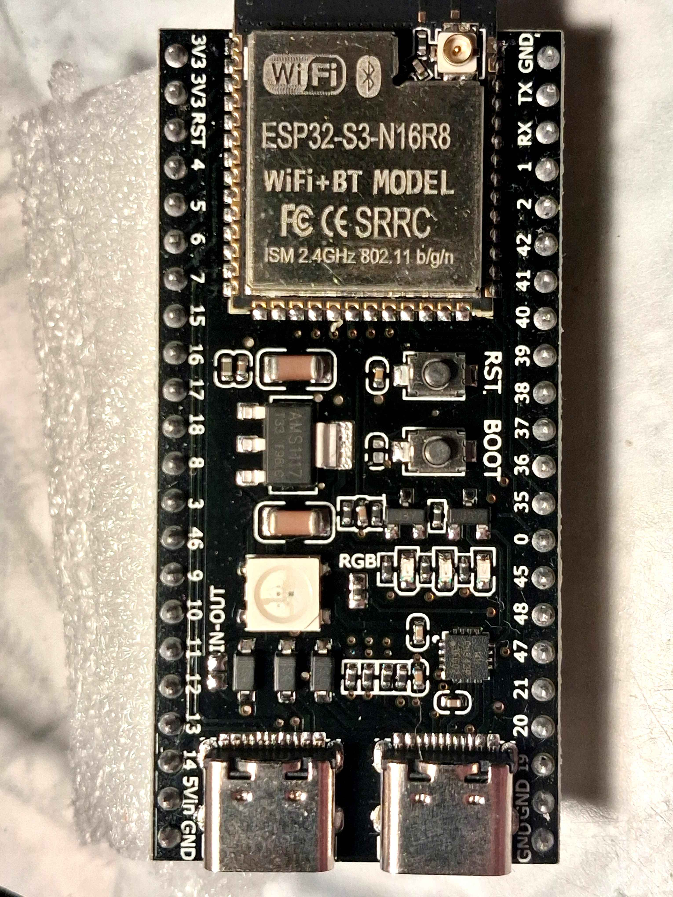
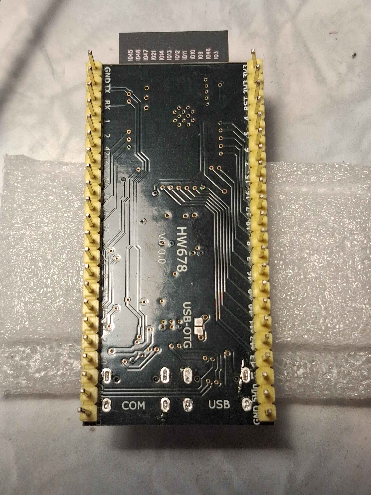

# The YD-ESP32-S3: VCC-GND Studio's ESP32-S3 board, and the HW-678 copies in hand

Copyright © 2026 Thor H. Linløkken <thj@thj.no>
License: CERN-OHL-S v2

Two boards sold as Espressif's ESP32-S3-DevKitC-1: the module the base
board carries and the firmware targets. They are not Espressif boards.
They carry a genuine ESP32-S3R8 on a copy of VCC-GND Studio's
YD-ESP32-S3. What is given as measured was measured on both boards on
2026-10-24, unless it carries a date of its own, from the lab computer,
with the synth repository's `tools/lab/esp32s3_probe` and esptool. Both
boards gave the same results, apart from their MAC addresses and
per-chip calibration fuses. What comes from the designer's schematic or
the seller's manual says so where it stands: none of it has been
measured here.

 

The top and the underside of one board (Thor's photos, 2026-11-14).

## Where it is bought

- **The boards in hand:** AliExpress, Veeket Store, the item "ESP32-S3
  WiFi Bluetooth Module 3.3-5V"
  (<https://www.aliexpress.com/item/1005009330328373.html>, read
  2026-11-28), variant "N16R8 Pin Soldered" or "N16R8 no soldered". The
  store is a reseller, and the listing prints neither `HW678` nor the
  designer's name; the two boards here came from it. The seller's manual
  from that page is `thirdparty/ESP32-S3_HW-678_manual_Veeket.pdf`: 35
  pages, most of them photos, with the board's size on page 30, its
  solder pads on page 31 and its pins on page 32.
- **The designer's own shops:** VCC-GND Studio's site
  (<https://vcc-gnd.com>, read 2026-11-28) links a store on AliExpress,
  <https://vcc-gnd.aliexpress.com/>, and one on Taobao,
  <https://vcc-gnd.taobao.com/>. By the designer's README its own boards
  are version 1.4, the one the schematic here describes. The AliExpress
  store asks for a login before it shows its items: whether it lists the
  N16R8 board, and at what price, has not been read.

## The design

The board's design is VCC-GND Studio's YD-ESP32-S3, which several
sellers offer under other names. The marks that tell the design (Prof. Michael P.
Harris's notes,
<https://github.com/profharris/YD-ESP32-S3_ESP32-S3-WROOM-1_Dev>, read
2026-11-28) are all on the two boards here:

- four LEDs in a row: the WS2812, then red, green and blue;
- solder pads marked `RGB` and `IN-OUT` on the top and `USB-OTG` on the
  underside;
- two USB-C sockets, one on a CH343P USB bridge;
- Espressif's pin order, with the rows one pin step further apart.

The designer publishes the design
(<https://github.com/vcc-gnd/YD-ESP32-S3>, read 2026-11-28). Two of its
files are in `thirdparty/`:

- `YD-ESP32-S3_schematic_V1.4_VCC-GND.pdf`: the schematic, V1.4, dated
  2022/9/23.
- `YD-ESP32-S3_dimensions_metric_VCC-GND.pdf`: the outline and the pin
  rows.

The HW-678 does not carry the designer's name and is taken to be a copy.
The designer's README says the copies are made from photos of version
1.2. The schematic is therefore evidence of what the design does, not a
measurement of these boards.

## Identity

| | the HW-678 | the official DevKitC-1 |
|---|---|---|
| Silkscreen (underside) | `HW678 V0.0.0` | `ESP32-S3-DevKitC-1 V1.x` |
| USB-to-UART bridge | WCH CH343, USB `1a86:55d3`, product string "USB Single Serial" | Silicon Labs CP2102N, `10c4:ea60` |
| Distance between the two pin rows | very close to 25 mm, measured by hand by Thor on 2026-11-27: 25.4 mm on the pins' 2.54 mm grid, and 25.40 mm in the designer's drawing | 22.86 mm |
| Size | 57.15 mm × 27.94 mm; 63.39 mm long with the module's antenna, which reaches past the board's end; 53.34 mm from the first pin of a row to the last (the designer's drawing). The seller's manual (page 30) has 57 mm × 28 mm and 63.3 mm, and the module 18 mm wide | |
| Native USB port | enumerates as Espressif's "USB JTAG/serial debug unit", `303a:1001`, with the `USB-OTG` solder pads open (seen 2026-11-19 on the board with MAC `44:bd:8d:6a:bc:34`, one cable, in the socket marked `USB`) | works as shipped, no jumper |
| Factory program | an Arduino sketch (arduino-lib-builder, ESP-IDF v4.4.4, built 2023-04-20); its bootloader fails its own SHA-256 check and boots anyway | Espressif's |
| MAC addresses | `44:bd:8d:6c:87:5c`, `44:bd:8d:6a:bc:34` | |

The factory program has been replaced with the probe on both boards.

## Chip and memory

- **Chip:** ESP32-S3 (QFN56), revision v0.2 (wafer major 0, minor 2), dual
  core, Wi-Fi and BLE 5. The eFuses describe an **ESP32-S3R8**: 8 MB PSRAM,
  vendor AP 3.3 V, 85 °C grade, inside the package; no flash in the package
  (flash capacity and vendor fuses read `None`).
- **Flash:** external, 16 MB, JEDEC ID `20 40 18` (manufacturer `0x20`).
  Runs in **QIO at 80 MHz**.
- **PSRAM:** AP Memory, generation 3, 64 Mbit, good-die *Pass*, read
  latency 10 cycles fixed. **Octal at 80 MHz**, memory test OK.
- **VDD_SPI** is forced to 3.3 V by eFuse (`VDD_SPI_FORCE`, `VDD_SPI_TIEH`),
  so the GPIO45 strap has no say over it.
- **Security:** factory state. No secure boot, no flash encryption, JTAG,
  USB-Serial/JTAG and USB-OTG all enabled, download mode enabled.

## Measured in the probe (CPU at 240 MHz)

| what | result |
|---|---|
| Free heap after boot | 320 KiB internal, 8189 KiB PSRAM |
| PSRAM to PSRAM `memcpy`, 8 × 1 MiB | 374 ms: 22.4 MB/s copied (each byte is read and written) |
| Wi-Fi scan, on the lab bench | 20 and 18 access points, strongest −49 and −53 dBm |

## Pins

The module takes GPIO26–32 (SPI flash) and **GPIO33–37 (octal PSRAM)**;
GPIO19/20 are native USB, GPIO43/44 UART0 on the CH343. The probe read every
other GPIO under the internal pull-down and then the pull-up:

- **GPIO0** reads high under both pulls: the BOOT button's pull-up. It is
  the only pin the board holds.
- **Every other free pin floats**: 1–18, 21, 38–42, 45–48. That includes
  the strapping pins GPIO3, 45 and 46, which therefore have no board
  pull-ups or pull-downs; the chip's internal defaults decide the boot.
- The strapping register reads `0x8`, the value the ROM prints as
  `boot:0x8 (SPI_FAST_FLASH_BOOT)`.

The scan finds pulls and drivers. It cannot rule out an LED with a series
resistor on a pin, because that loads the pin too weakly to win against
the internal pull.

## Header pins

Read from `esp32s3_hw678_top.jpg`, Thor's photo of the top of one board
(2026-11-14), against the official board's header table
(`thirdparty/esp-dev-kits-en-master-esp32s3.pdf`, Header Block).

- **The pin order is the official board's, position for position.** The
  labels are the chip's GPIO numbers. From the antenna end:
  - left row (the official J1):
    `3V3 3V3 RST 4 5 6 7 15 16 17 18 8 3 46 9 10 11 12 13 14 5Vin GND`
  - right row (the official J3):
    `GND TX RX 1 2 42 41 40 39 38 37 36 35 0 45 48 47 21 20 19 GND GND`

  Both rows have 22 pins. The one label that differs is `5Vin`, where
  the official board prints `5V`. The pin diagram in the seller's manual
  (page 32) has the same two rows, position for position.
- **The underside** (`esp32s3_hw678_bottom.jpg`) repeats the same
  labels, and carries the silkscreen `HW678 V0.0.0`, the `USB-OTG`
  solder pads (unbridged in the photo) and the two sockets' names,
  `COM` and `USB`.

## Solder pads

Three pairs, each a place for a 0 Ω link. What each connects is taken
from the designer's schematic; the quotes are the seller's manual
(page 31). None of it has been measured here.

- **`IN-OUT`**, on the top beside pins 11 and 12, next to three parts in
  diode packages; in the photo the pads look unbridged. The link lies
  across diode D3, whose anode is the `5Vin` pin and whose cathode is
  the board's 5 V rail. Open, the pin is an input only; bridged, the
  rail reaches the pin. "Short or use 0 ohm resistor to connect the
  5Vin pin to output 5V."
- **`USB-OTG`**, on the underside; unbridged in the photo. The link lies
  across diode D2, whose anode is the supply pin of the socket marked
  `USB` and whose cathode is the 5 V rail. Bridged, the rail reaches
  that socket and powers a device plugged into it. The socket's data
  pair goes straight to GPIO19 and GPIO20: the pads are in the supply
  line only, and have no say over which of the chip's USB controllers
  owns the socket (For the firmware, USB device). "Short or use 0 ohm
  resistor to connect, the Type-C port of the silk-screened USB can be
  used for OTG function."
- **`RGB`**, beside the WS2812: the link joins GPIO48 to the LED's data
  input. "Short or use 0 ohm resistor to connect the RGB lamp can be
  used normally (default connection)." The probe lit the LED on both
  boards, so the link is in place on them.

## The 5 V pin

The pin order is the official board's, so either board plugs into the
same place. What the 5 V pin does is not the same on the two, and there
are three cases:

- **Espressif's board:** the supply pin of each USB socket reaches
  `VCC_5V`, the net of the `5V` header pin, through a 1N5819 Schottky
  diode of its own (D1 for the UART socket, D7 for the native one;
  `thirdparty/ESP32-S3-DevKitC-1_Reference_Design/01_Schematic/SCH_ESP32-S3-DevKitC-1_V1.1_20221130.pdf`,
  sheet 2). A powered USB socket lifts the pin, and power fed in at the
  pin cannot reach either USB socket.
- **The HW-678 as shipped,** its `IN-OUT` pads open: 5 V fed in at
  `5Vin` reaches the board's rail through D3, one diode drop lower, and
  the rail cannot reach the pin, so the pin does not give out the USB
  sockets' 5 V. Each socket feeds the rail through a diode of its own
  (D1 for `COM`, D2 for `USB`): the board runs from either socket, as
  it did under the probe, and power fed in at the pin cannot reach a
  socket.
- **The HW-678 with `IN-OUT` bridged:** the pin is on the rail and
  gives out 5 V, as Espressif's board does. D1 and D2 still keep power
  fed in at the pin from the sockets.

In both of the HW-678's cases the `USB` socket is kept apart by D2
alone: with `USB-OTG` bridged, the rail is on that socket's supply pin.

The HW-678's cases are read from the designer's schematic, and the
seller's manual says the same of `IN-OUT`. Neither has been measured on
a board: the voltage on `5Vin` with only a USB socket powered tells the
two apart. The base board is drawn for all three cases
(`requirements.md`, Power).

## LEDs

Three LEDs: red, green and blue. The seller's manual (page 32) names them
"Red: Power Supply, Green: TX, Blue: RX", which is what was observed:

- **Red:** always on while powered.
- **Green:** the CH343's **TX** LED. It blinks once for every line the
  console prints: once a second under hello_world, once per step of the
  probe's LED sequence (observed). It shows the console's traffic, not a GPIO.
- **Blue:** the CH343's **RX** LED. It is dark while nothing is sent, and it
  lit in bursts with brief pauses while esptool wrote the flash, one burst
  per region (observed).
- **RGB:** a large WS2812 on **GPIO48**, as on the official v1.0 board, with
  the usual green, red, blue byte order: the probe's red, green, blue showed
  in that order (observed). **GPIO38 has no LED**: the probe's three white
  blinks there showed nothing. Its data input reaches GPIO48 through
  the `RGB` solder pads.

## For the firmware

- The chip and memory are genuine, and the faster settings (QIO 80 MHz
  flash, 80 MHz octal PSRAM, 240 MHz CPU) are stable.
- **Console:** the firmware's console is on the CH343's UART0 at 115200,
  the socket marked `COM`. esptool reaches the ROM and runs its stub through
  that socket too, RTS resetting the chip with no hand on a key, and writes
  the flash through it. The socket marked `USB` is the chip's own
  USB-Serial/JTAG controller on GPIO19/20, which shares its PHY with USB-OTG:
  the firmware keeps that controller off, so the socket is OTG's. With both
  sockets cabled, the CH343 is the higher of the two ACM numbers.
- **USB device:** the socket marked `USB` is USB-OTG's, and the chip's
  `USB_PHY_SEL` eFuse is burned to 1 on the board with MAC `44:bd:8d:6c:87:5c`
  so the internal PHY belongs to that controller. Unburned, the ROM gives the
  PHY to the USB-Serial/JTAG side and no firmware can put a USB device on that
  socket: measured with the full stack up, the OTG core in device mode with a
  valid session and out of soft disconnect, and the host never seeing a
  connect. The burn costs the serial/JTAG function on that socket alone;
  `COM`, UART0 and the flashing path are untouched.
- **Pins:** GPIO33–37 are gone to the PSRAM. Plan from the free list
  above, not from the DevKitC-1's schematic.
- **PSRAM is enabled only if the build includes `esp_psram`.** With
  `MINIMAL_BUILD`, `CONFIG_SPIRAM=y` in `sdkconfig.defaults` is dropped
  silently unless a component requires `esp_psram`; check the generated
  `sdkconfig`.
- **Access on the lab computer:** the CH343 needed a udev rule
  (`/etc/udev/rules.d/61-ch343.rules`, `1a86:55d3` to `plugdev` with
  `uaccess`) before esptool could open the ports. Without it, the port is
  `root:dialout`, and esptool reports the permission error as "busy or
  doesn't exist".

## Reproducing

In the synth repository:

```sh
cd tools/lab/esp32s3_probe
../../esp_idf.sh idf.py set-target esp32s3 build
../../esp_idf.sh idf.py -p /dev/ttyACM0 flash monitor
../../esp_idf.sh python -m espefuse --port /dev/ttyACM0 summary
```

The probe's lines start with `PROBE`. After the report it repeats the
WS2812 sequence until it is reset.
